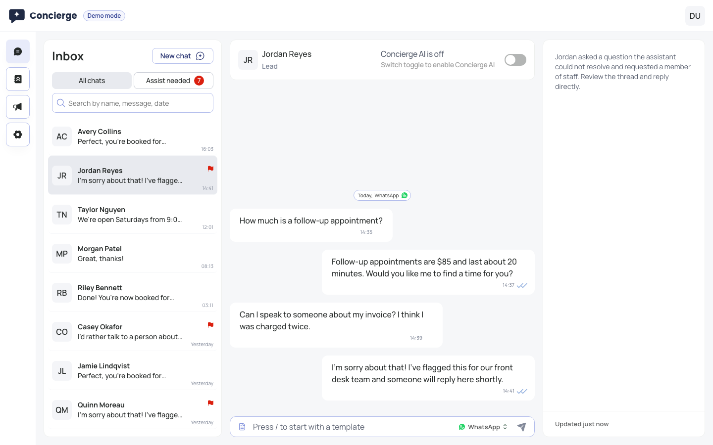

# Concierge Dashboard

An open-source dashboard for an AI chat assistant that answers customers on
**WhatsApp** and **website live chat**, built with Next.js 14, React Query,
Tailwind CSS and Radix UI.



It was the production frontend of a startup serving clinics, and is now
released under the MIT license. It runs out of the box in **demo mode** with
realistic fake data. No backend, accounts or API keys are needed.

## Features

- **Unified inbox**: WhatsApp and live chat conversations in one list, with
  real-time updates, search, infinite scroll and delivery/read receipts.
- **AI to human handover**: an "assistance needed" queue, one-click takeover and
  hand-back, plus AI-generated conversation summaries.
- **WhatsApp templates**: create templates and submit them for approval, and
  pick approved templates when the 24-hour messaging window is closed.
- **Campaigns**: schedule WhatsApp broadcasts to selected contacts and track
  sent, failed, read and replied rates.
- **Contacts**: lead and client management with bulk actions.
- **Onboarding**: guided setup for the website widget, WhatsApp Business
  (Meta embedded signup) and training the assistant on your website.
- **Settings**: business profile, assistant customization, widget channels and
  plan usage.
- **White-label**: product name, links and colors are set through environment
  variables and CSS variables.

## Quick start

```bash
pnpm install
pnpm dev
```

Open http://localhost:3000. With no environment variables set, the app uses an
in-memory mock API and a demo user. Data resets when you reload the page, and
a simulated customer writes in every so often so you can watch real-time
updates and the AI auto-reply.

## Connecting a real backend

```bash
cp .env.example .env.local
```

| Variable                                                        | Purpose                                                         |
| --------------------------------------------------------------- | --------------------------------------------------------------- |
| `NEXT_PUBLIC_API_URL`                                           | REST API base URL. Unset means demo mode.                       |
| `NEXT_PUBLIC_WS_URL`                                            | WebSocket base URL for live updates.                            |
| `NEXT_PUBLIC_CLERK_PUBLISHABLE_KEY`, `CLERK_SECRET_KEY`         | Enables [Clerk](https://clerk.com) login. Unset means no login. |
| `NEXT_PUBLIC_CLERK_TOKEN_TEMPLATE`                              | Optional Clerk JWT template for backend tokens.                 |
| `NEXT_PUBLIC_FACEBOOK_APP_ID`, `NEXT_PUBLIC_FACEBOOK_CONFIG_ID` | Meta WhatsApp embedded signup.                                  |
| `NEXT_PUBLIC_WIDGET_SCRIPT_URL`                                 | Script customers embed to load the chat widget.                 |
| `NEXT_PUBLIC_BILLING_URL`                                       | Plan management link. Billing buttons are hidden when unset.    |
| `NEXT_PUBLIC_ONBOARDING_CALL_URL`                               | Optional "book a setup call" link.                              |
| `NEXT_PUBLIC_TERMS_URL`                                         | Terms of service link.                                          |
| `NEXT_PUBLIC_PRODUCT_NAME`, `NEXT_PUBLIC_SUPPORT_EMAIL`         | Branding.                                                       |

The backend contract (REST endpoints, WebSocket protocol, auth) is documented
in [docs/API.md](docs/API.md). You can also skip that contract entirely by
writing your own `ApiClient`.

## Architecture

```
src/
  app/                 Routes and layouts only (thin)
  features/            One folder per feature: components + React Query hooks
    chat/              Inbox, messages, handover, summaries
    contacts/
    campaigns/
    templates/
    settings/
    onboarding/
    shell/             Header, sidebars, user menu, plan alerts
    workspace/         Shared workspace, settings, quota and widget hooks
  lib/
    api/               ApiClient interface, HTTP + WebSocket client, mock client
    auth/              Auth adapter (Clerk or demo) behind useSession()
    query-keys.ts      Every React Query key
  config/              Typed env and brand config
  components/ui/       Radix/shadcn primitives
```

Three seams keep the UI decoupled from infrastructure:

- **`ApiClient`** (`src/lib/api/client.ts`) is the only way the UI reads or
  writes data, including real-time events. `ApiProvider` picks the HTTP or
  mock implementation.
- **`useSession()`** (`src/lib/auth/session.tsx`) exposes the user, token and
  sign-out. Clerk is one adapter; adding another means writing a small bridge.
- **`brand` / `env`** (`src/config/`) hold every user-facing name, email and
  link.

## Theming

Brand colors are CSS variables at the top of `src/app/globals.css`
(`--brand-*`, `--primary-*`, as RGB channels). Change them to re-theme the
whole app. Replace `src/components/icons/Logo.tsx` and `src/app/icon.svg`
with your own logo.

## Scripts

| Command                     |                            |
| --------------------------- | -------------------------- |
| `pnpm dev`                  | Start the dev server       |
| `pnpm build` / `pnpm start` | Production build and serve |
| `pnpm typecheck`            | TypeScript                 |
| `pnpm lint`                 | ESLint                     |
| `pnpm format`               | Prettier                   |

## Contributing

See [CONTRIBUTING.md](CONTRIBUTING.md).

## Acknowledgements

This project wouldn't exist without the people who helped shape it along the
way. Thank you for your collaboration at different stages of this journey:

- [Misha Tsvik](https://www.linkedin.com/in/mtsvik/), product
- [Uma Gadhvi](https://www.linkedin.com/in/uma-gadhvi-851684230/), product
- [Leo Kolyazin](https://www.linkedin.com/in/leok98/), design
- [Dmitry Shmakov](https://www.linkedin.com/in/shmakovdima/), engineering
- [Cosmin Gheorghilă](https://www.linkedin.com/in/cosmin-gheorghila/), engineering
- [Aleksei Kozharin](https://www.linkedin.com/in/aleksei%F0%9F%92%BE-kozharin-869001130/), engineering

## License

[MIT](LICENSE)
